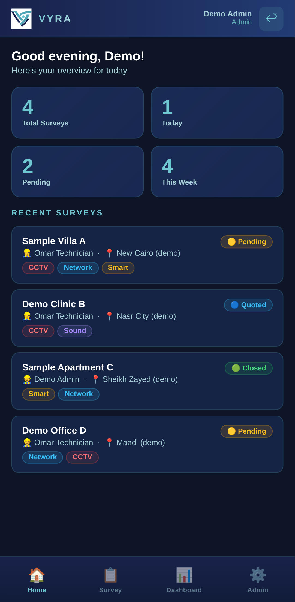
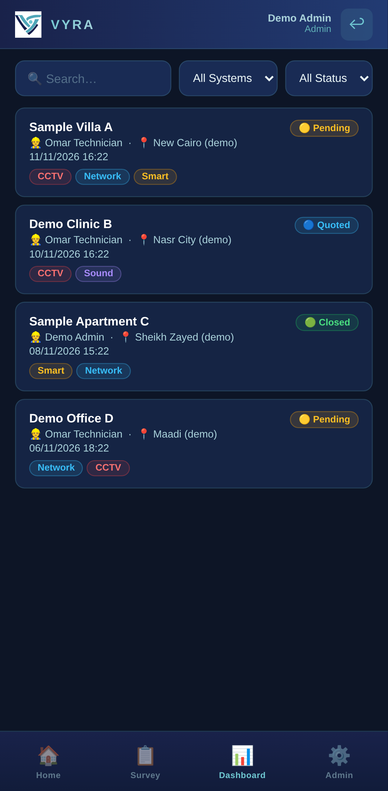
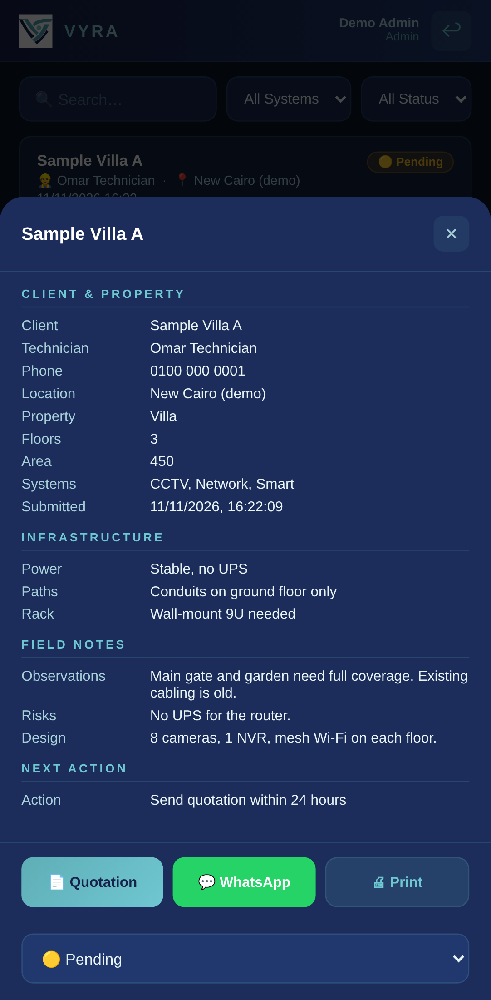
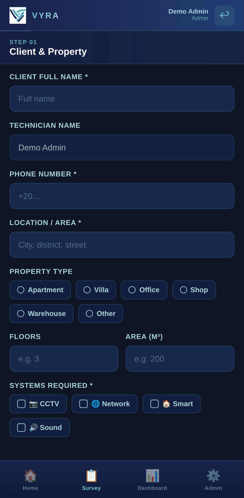
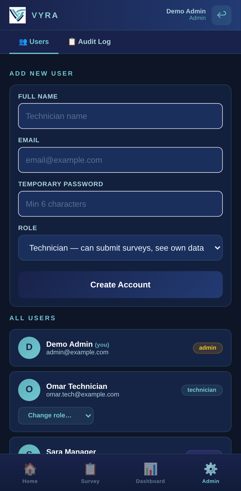
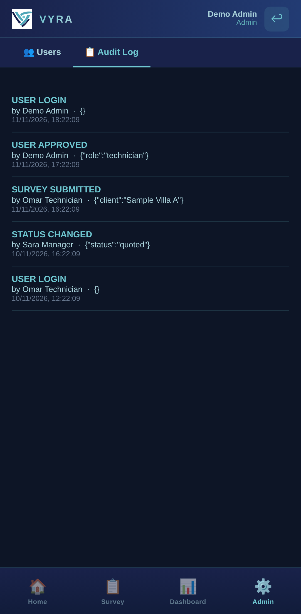
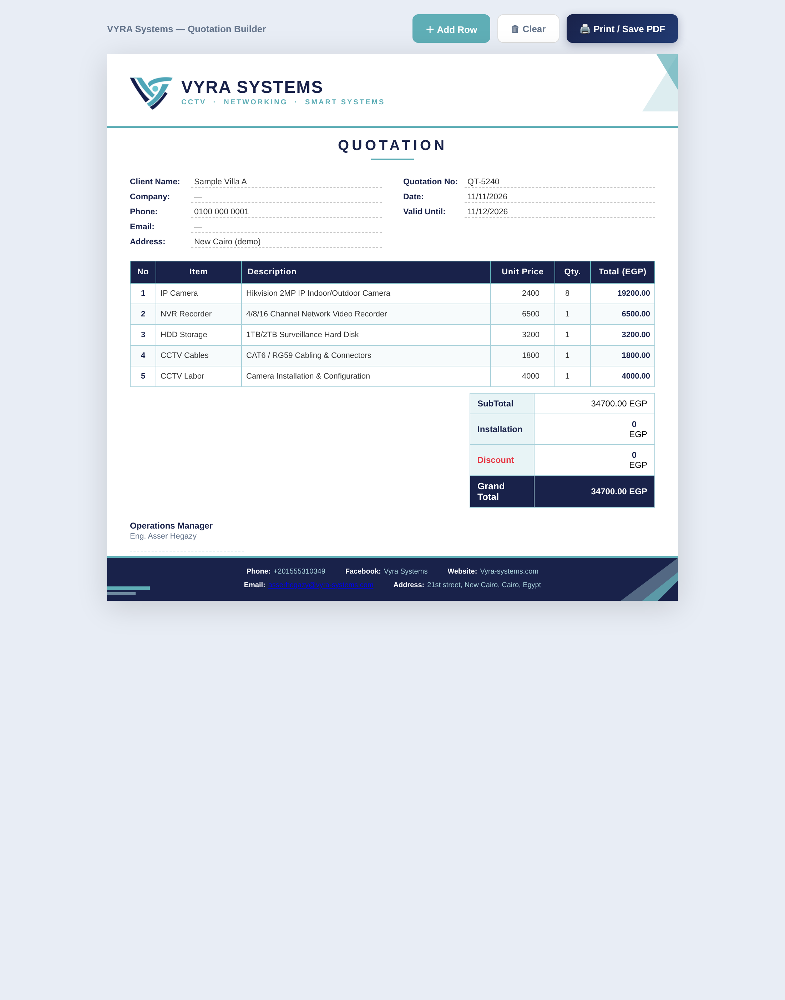
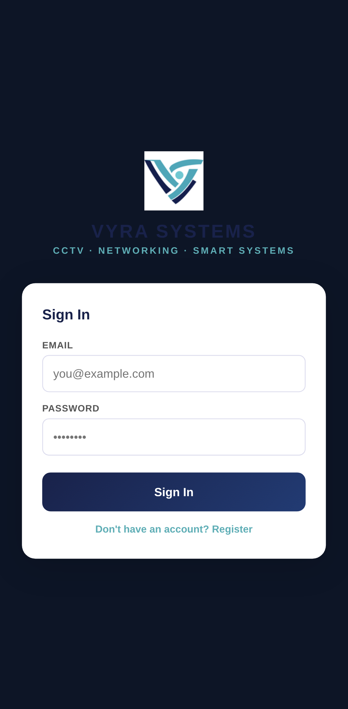
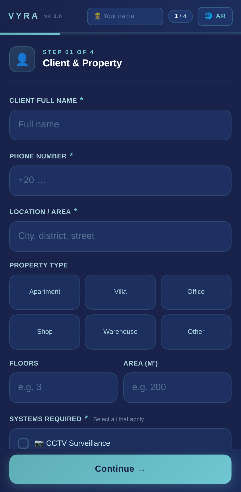

# VYRA Site Survey

A mobile web app that VYRA Systems technicians use on site before installing CCTV, networking, smart home and sound systems. The technician fills in a guided survey on their phone, the office reviews it, turns it into a quotation and prints a survey report.

It installs on a phone like an app (PWA) and is built with plain HTML, CSS and JavaScript on Firebase.

All names, phones and addresses in the screenshots below are fake demo data.

## Screenshots

| Home | Surveys | Survey details |
|---|---|---|
|  |  |  |

| New survey | Admin: users and roles | Admin: audit log |
|---|---|---|
|  |  |  |

**Quotation builder** (prints or saves as PDF)



| Sign in | Public survey form (English / Arabic) |
|---|---|
|  |  |

## What it does

- **Guided survey:** client and property, infrastructure, systems required, field notes and next action, step by step.
- **Accounts and roles:** new sign-ups wait for admin approval. Roles decide what each person sees and can change:

  | Role | Submit surveys | See surveys | Change status | Manage users, audit log |
  |---|---|---|---|---|
  | Admin | Yes | All | Yes | Yes |
  | Manager | No | All | Yes | No |
  | Technician | Yes | Own only | Own only | No |
  | Pending | No | No | No | No |

- **Audit log:** sign-ins, submitted surveys, approvals and role changes are recorded.
- **Survey details:** search and filter by system and status, then open a quotation, share a summary on WhatsApp, or print the report.
- **Quotation builder:** pre-filled from the survey, editable rows, totals, discount, print or save as PDF.
- **Offline-ready install:** service worker and manifest, with an in-app "Update" prompt when a new version is published.

## Files

| File | Purpose |
|---|---|
| `app.html` | The main app: sign-in, home, surveys, new survey, admin (Firebase Auth + Firestore) |
| `quotation.html` | Quotation builder |
| `survey-print.html` | Printable survey report |
| `index.html` | Earlier public survey form (English/Arabic) that sends answers to a Google Sheet |
| `dashboard.html` | Earlier dashboard that reads that Google Sheet |
| `firestore.rules` | Firestore security rules for `app.html` |
| `sw.js`, `manifest.json`, `icon-*.png` | Install and offline support |

## Security rules

`firestore.rules` enforces the roles above on the server, so they hold even if someone edits the page in their browser:

- New accounts can only create their own profile, as `pending`. Only the owner account can start as admin.
- Only an admin can change roles, and only the role field.
- Technicians can read and create only their own surveys. Updates are limited to the survey status.
- The audit log is append-only and readable by admins only.

To apply them: Firebase Console > Firestore Database > Rules, paste the file, Publish. Keep a copy of the old rules first so you can roll back.

## Run it locally

No build step. Serve the folder with any static server, for example:

```bash
python -m http.server 8080
```

Then open http://localhost:8080/app.html. Sign-in uses the Firebase project configured in `app.html`.
